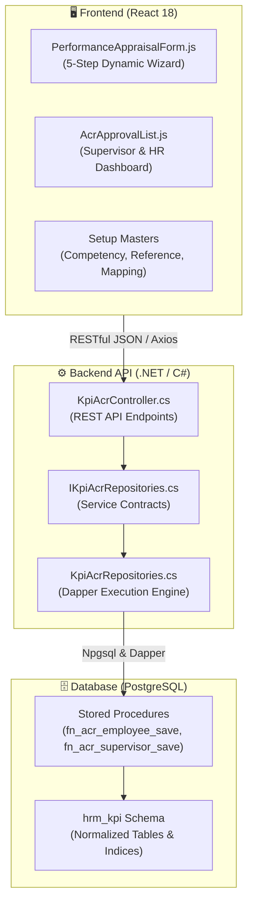
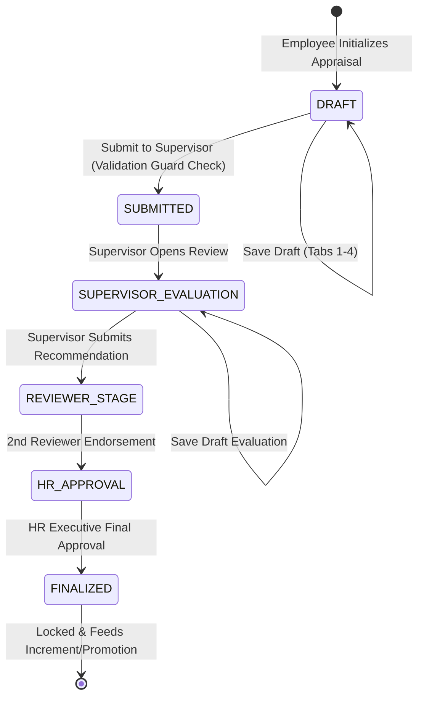

# 🎯 Enterprise Performance Appraisal & KPI Management System (ACR / KPI)

[](https://react.dev/)
[](https://dotnet.microsoft.com/)
[](https://www.postgresql.org/)
[](https://github.com/DapperLib/Dapper)
[]()

An enterprise-grade, full-stack **Annual Confidential Report (ACR) and Key Performance Indicator (KPI) Management Module**. 

Engineered for mid-to-large scale organizations, this module manages the complete lifecycle of employee performance appraisals — featuring a responsive 5-step evaluation wizard, multi-tier hierarchical approvals, real-time dynamic score weighting, draft auto-save persistence, and transactional PostgreSQL stored procedures.

---

## 🌟 Key Highlights & Engineering Features

- **Dynamic 5-Stage Appraisal Wizard:** Intuitive React wizard with active tab progress tracking, form state preservation across steps, and automated draft saving.
- **Hierarchical Approval Pipeline:** Strict multi-tier approval flow (`Employee Draft` ➔ `Submitted to Supervisor` ➔ `1st Appraiser Scoring` ➔ `2nd Reviewer Moderation` ➔ `HR / Executive Finalization`).
- **Mathematical Weighting & Validation Guards:**
  - Real-time client & database validation ensuring activity weights strictly total $100\%$.
  - Completion enforcement: blocks submission if mandatory ratings or commentary fields are absent.
- **High-Performance Backend:** Clean architecture utilizing ASP.NET Core with Dapper micro-ORM for high-throughput, low-latency API execution.
- **PostgreSQL Transactional Procedures:** Full atomic transactions ensuring zero data loss, state consistency, and comprehensive audit timestamps.

---

## 🏗️ System Architecture



---

## 🔄 Appraisal Lifecycle State Machine



---

## 📂 Repository Layout

```
kpi-acr-module/
├── frontend/                              # Clean React UI Application Layer
│   └── src/pages/Kpi/
│       ├── PerformanceAppraisalForm.js   # Main 5-tab appraisal evaluation wizard
│       ├── AcrApprovalList.js            # Hierarchical approval dashboard
│       ├── KpiCompetency.js              # Behavioral & functional competency setup
│       ├── KpiReference.js               # Appraisal cycle & grading scale master
│       └── KpiAppraiserMapping.js        # Dynamic employee-to-evaluator hierarchy
│
├── backend/                               # ASP.NET Core API Layer (.NET 8)
│   ├── Controllers/KpiAcrController.cs   # Web API endpoints
│   ├── Interfaces/IKpiAcrRepositories.cs # Repository contracts
│   ├── Requests/KpiAcrRequests.cs        # Request DTO models
│   ├── Responses/KpiAcrResponses.cs      # Response DTO models
│   ├── Repositories/KpiAcrRepositories.cs# Dapper database access layer
│   ├── Common/ApiResponse.cs             # Standardized JSON response envelope
│   ├── Common/DatabaseHelper.cs          # Schema & function name constants
│   ├── appsettings.json                  # Database connection configuration
│   └── Enterprise.HRM.KPI.csproj         # .NET 8 Project file
│
├── database/                              # PostgreSQL Relational Engine
│   ├── 01_kpi_acr_schema.sql             # Table schemas, sequences, and check constraints
│   ├── 02_kpi_acr_setup_functions.sql    # CRUD procedures for reference & competency masters
│   ├── 03_kpi_acr_appraisal_functions.sql# Transactional evaluation save & calculation routines
│   └── 04_kpi_menu_registration_guide.sql# RBAC menu integration script
│
└── docs/
    └── SYSTEM_SPECIFICATION.md           # Domain specification & scoring model
```

---

## 📊 Database Schema & Stored Procedure Reference

| Function Name | Description | Output |
| :--- | :--- | :--- |
| `fn_acr_employee_save` | Atomically commits employee self-ratings, activities, and future goals | Status Code & Message |
| `fn_acr_supervisor_save` | Records supervisor ratings, competencies, and recommended training | Action Status |
| `fn_acr_hr_save` | Finalizes composite scoring and transitions state to Approved | Approval Record |
| `fn_acr_form_data` | Aggregates all tabs data for a specific employee & reference cycle | Full JSON DTO |
| `fn_acr_master_datalist`| Role-filtered list of appraisals pending supervisor/HR review | Data Table |

---

## 🚀 Integration & Setup Guide

### 1. Database Setup (PostgreSQL)
Execute the SQL scripts in order against PostgreSQL (13+):
```bash
psql -U postgres -d your_db -f database/01_kpi_acr_schema.sql
psql -U postgres -d your_db -f database/02_kpi_acr_setup_functions.sql
psql -U postgres -d your_db -f database/03_kpi_acr_appraisal_functions.sql
```

### 2. Backend API Setup (.NET 8)
```bash
cd backend
dotnet restore
dotnet run
```
Navigate to `http://localhost:5000` to interact with endpoints via **Swagger UI**.

### 3. Frontend Integration
The page components live in `frontend/src/pages/Kpi/` and are meant to be dropped into a React dashboard that provides the shared `components`, `services/ApiService` and validation helpers they import.

---

## 👨‍💻 Author
- **Aminul Islam** ([`RD-Aminul`](https://github.com/RD-Aminul)), [portfolio](https://rd-aminul.github.io)
